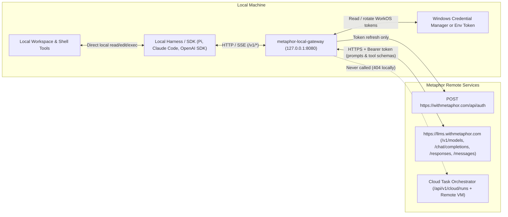
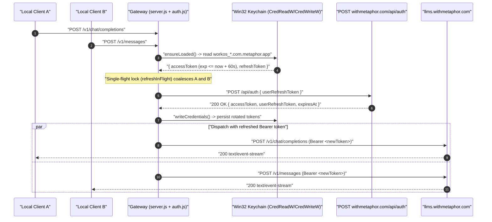
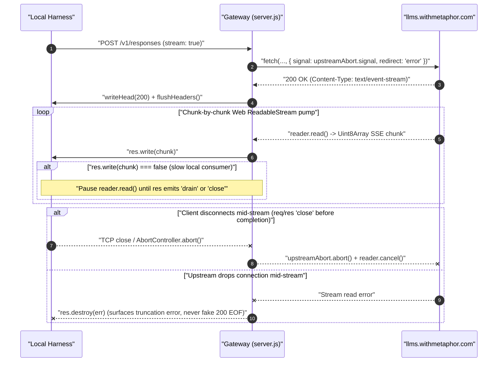

# Architecture

`metaphor-local-gateway` is a stateless, loopback-only HTTP proxy built on Node.js standard library primitives (`node:http`, `node:crypto`, `node:child_process`, `node:util`, `globalThis.fetch`). It exposes Metaphor's multi-protocol inference gateway (`https://llms.withmetaphor.com`) to local coding harnesses while keeping workspace files, shell commands, and tool approvals on the local machine.

## Module Layout

| File | Responsibility |
|---|---|
| `src/cli.js` | Parses CLI flags (`--help`, `--version`, `--host`, `--port`), loads optional `.env` via `process.loadEnvFile`, starts the HTTP listener, and performs clean `SIGINT`/`SIGTERM` connection teardown. |
| `src/server.js` | HTTP request lifecycle, `Retry-After` cooldown gate, upstream `fetch` dispatch, reactive `401` refresh retry, unbuffered SSE streaming with TCP backpressure, and client-disconnect abort propagation. |
| `src/validation.js` | Startup config validation (loopback enforcement), constant-time `LOCAL_API_KEY` check, two-stage envelope + JSON body boundary validation, and protocol-native error formatting. |
| `src/auth.js` | Access-token lifecycle, JWT `exp` decoding (`60s` proactive skew), single-flight refresh coalescing via `POST /api/auth`, and credential persistence hooks. |
| `src/keychain-win32.js` | Windows Credential Manager reader/writer invoking `advapi32.dll` (`CredReadW` / `CredWriteW`) via non-interactive PowerShell with `stdin`-piped secret writes. |

## 1. Direct Inference Path vs. Avoided Cloud-Task Path

The Metaphor client ecosystem contains two separate backend paths:
1. **Cloud-task orchestration (`POST https://withmetaphor.com/api/v1/cloud/runs`)**: Provisions a remote virtual machine running `@withmetaphor/darwin`, requiring remote repository synchronization and remote tool execution.
2. **Direct inference gateway (`https://llms.withmetaphor.com`)**: Stateless Vercel AI Gateway pass-through serving `/v1/models`, `/v1/chat/completions`, `/v1/responses`, and `/v1/messages` with `Authorization: Bearer <METAPHOR_ACCESS_TOKEN>`.

`metaphor-local-gateway` targets **only** the direct inference gateway and rejects `/api/v1/cloud/runs` (and all other non-inference paths) at the local HTTP boundary with `404`.

## 2. Authentication and Single-Flight WorkOS Token Refresh

### Credential Resolution Order

`createMetaphorAuth` (`src/auth.js`) resolves credentials in priority order:

1. **Environment variables (`METAPHOR_ACCESS_TOKEN` / `METAPHOR_REFRESH_TOKEN`)**:
   - Used on macOS, Linux, CI, or when explicitly overriding desktop credentials on Windows.
   - `decodeJwtExpSeconds` decodes the middle `base64url` JWT payload segment to extract `exp` when present.
   - Rotated tokens remain in process memory and never overwrite OS credential storage (`!usingEnvCredentials`).
2. **Windows Credential Manager (`src/keychain-win32.js`, `process.platform === "win32"`)**:
   - Reads the three generic credentials written by the Metaphor desktop app's Rust `keyring` store (`CRED_TYPE_GENERIC = 1`, `CRED_PERSIST_ENTERPRISE = 3`):
     - `workos_access_token.com.metaphor.app`
     - `workos_refresh_token.com.metaphor.app`
     - `workos_access_token_expires_at.com.metaphor.app`
   - Decodes UTF-16LE or UTF-8 blobs on read, caches credentials in memory so normal requests spawn zero subprocesses, and writes rotated credentials back via `stdin` as UTF-16LE (`CredWriteW`) so the desktop app and local gateway stay synchronized.

### Proactive Skew, Single-Flight Coalescing, and Reactive `401` Recovery

- **Proactive refresh (`EXPIRY_SKEW_SECONDS = 60`)**: Before dispatching upstream, `isExpiredOrExpiring()` checks `nowSeconds() + 60 >= expiresAtSeconds`.
- **Single-flight coalescing (`refreshInFlight`)**: Concurrent requests observing an expiring token await the same `POST <METAPHOR_API_URL>/auth` promise (`{ "userRefreshToken": "<token>" }`, `redirect: "error"`, `15s` timeout), avoiding duplicate rotation races on single-use refresh tokens.
- **Reactive `401` retry**: If `llms.withmetaphor.com` returns `401` on a token that had not yet reached local expiry and a refresh token is available, `src/server.js` calls `getAccessToken({ forceRefresh: true })`. If a new token is obtained, the initial `401` body is canceled and the request is retried once; otherwise, the original upstream `401` response is returned verbatim.

## 3. Boundary Validation, Streaming, Cancellation, and `Retry-After`

### Two-Stage Request Boundary Validation (`src/validation.js`)

1. **Loopback-only binding**: `validateGatewayConfig` rejects any `HOST` outside `127.0.0.1`, `::1`, or `localhost` before opening a socket.
2. **Envelope check before reading body (`validateRequestEnvelope`)**:
   - Validates URL syntax, `LOCAL_API_KEY` (`crypto.timingSafeEqual` over `Authorization: Bearer` or `x-api-key`), allowed route (`404`), allowed HTTP method (`405` + `Allow` header), and `Content-Type: application/json` (`415`) **before** buffering any request payload bytes.
3. **Bounded body read & schema check (`readRequestBody` + `validatePostBody`)**:
   - Caps `POST` payloads at `32 MiB` (`413` if exceeded).
   - Validates JSON object root, non-empty `model` string without whitespace/control characters, optional boolean `stream`, and route-specific fields (`messages` on `/v1/chat/completions`, `input` on `/v1/responses`, `messages` + positive integer `max_tokens` on `/v1/messages`).
   - Formats local boundary errors using the route's native error envelope (`anthropic` on `/v1/messages`, `openai` on all other routes).
   - Forwards the original `rawBodyBuffer` byte-for-byte once validated.

### Header Sanitization

- **Inbound -> Upstream allowlist (`SAFE_FORWARD_REQUEST_HEADERS`)**:
  Only `accept`, `content-type`, `anthropic-version`, `anthropic-beta`, `openai-beta`, `session_id`, and `x-client-request-id` are forwarded. Incoming `authorization`, `x-api-key`, `cookie`, `chatgpt-account-id`, and custom headers are stripped, and `Authorization: Bearer <Metaphor token>` is set (`redirect: "error"`).
- **Upstream -> Client allowlist (`SAFE_UPSTREAM_RESPONSE_HEADERS`)**:
  Only `content-type`, `cache-control`, `retry-after`, `x-request-id`, `request-id`, `x-ratelimit-limit`, `x-ratelimit-remaining`, and `x-ratelimit-reset` are copied to the local response, with `cache-control: no-store` defaulted and `x-accel-buffering: no` added for `text/event-stream`.

### Unbuffered SSE Streaming, Backpressure, and Cancellation (`src/server.js`)

### `Retry-After` Cooldown Enforcement

When upstream returns HTTP `429` or `503` with a `Retry-After` header (delta-seconds or HTTP-date), `parseRetryAfterMs` updates `retryAfterUntilMs` and forwards the upstream error and `Retry-After` header verbatim. Any request arriving before `retryAfterUntilMs` expires is rejected immediately at the local boundary with HTTP `429` and `Retry-After: <remaining whole seconds>` so upstream is never polled during an active cooldown window.
